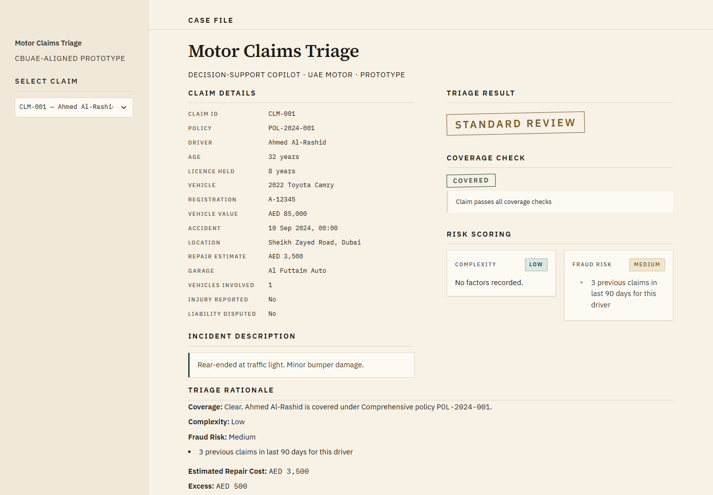

# Motor Claims Triage & Decision-Support Copilot

[](https://github.com/ahmedbasolan/motor-claims-triage/actions/workflows/ci.yml)

A prototype claims triage system for UAE motor insurance that automates coverage checks, risk scoring, and decision recommendations. [MIT](LICENSE) licensed.

**Status: prototype.** Logic is exercised against 38 synthetic claims and 8 synthetic
policies. It has never run against real claims, and the scoring thresholds are
unvalidated guesses, not calibrated against outcome data. The `eval/` package
measures that gap (see [Calibration](#calibration)) — it reports what outcomes
would need to say for the thresholds to be right, and which thresholds the
current data can even distinguish.

Every claim carries a ground-truth label (`EXPECTED_RECOMMENDATIONS` in
`motor_claims/mock_data.py`), and the dataset is built so that every rule in the engine
fires on at least one claim. Tests assert the engine reproduces the labels and
that each rule branch is exercised — a silent behaviour change fails the suite.



## Quick Start

```bash
# Install dependencies
pip install -e ".[dev]"

# Run API
python api.py
# Or: uvicorn api:app --reload --port 8000

# Run Streamlit UI
streamlit run app/ui.py

# Run tests
pytest tests/ -v
```

## Features

- **Coverage Verification**: Checks driver exclusions, vehicle matches, use-case restrictions, and policy validity
- **Complexity Scoring**: Evaluates multi-vehicle incidents, injuries, liability disputes, and repair cost ratios
- **Fraud Risk Detection**: Flags recently-purchased policies with high claims, repeated claims, and inconsistent stories
- **Recommendation Engine**: Fast-track / Standard Review / Investigate based on risk assessment
- **Narrative Generation**: Human-readable rationale for handler notes
- **API & UI**: FastAPI endpoint + Streamlit dashboard

## Rules implemented

| Area | Rules |
|---|---|
| Coverage | 3 hard checks (policy in force, driver not excluded, vehicle matches) + 4 use-case exclusions (`rental_use`, `ride_hailing_use`, `taxi_use`, `delivery_use`) detected from 6 description keywords + 1 third-party advisory |
| Complexity | 5 factors: multi-vehicle, injury reported, liability disputed, repair cost vs vehicle value (2 tiers), young/inexperienced driver |
| Fraud | 5 factors: recently-purchased policy with high claim, repeat claims in 90 days (2 tiers), story inconsistency (4 keyword families), thin documentation for a high-value estimate |
| Decision | 3 outcomes, each with a stated reason: fast-track, standard review, investigate |

105 tests: `pytest tests/ -v` — engine and ground-truth labels, eval harness,
API endpoints (all 38 labels round-tripped over HTTP, plus outcome capture at
`/feedback`), and the dashboard
(each of the 38 claims round-tripped through the sidebar: verdict and
coverage stamps, every fact-grid figure, risk levels, prose values in mono,
plus the bulk table's columns and the headline metrics — all checked
against the claim data and the engine), a theme liveness check (every
Streamlit element the theme styles must still exist in the installed
version's frontend assets), and six in-browser render checks that read
computed styles out of a real Chromium — fonts, tints and DOM structure,
the surfaces AppTest cannot see. The render checks need
`pip install playwright && python -m playwright install chromium` and
skip where Chromium is absent.
Run automatically on every push and PR by
GitHub Actions (`.github/workflows/ci.yml`): ruff check (with the B, C4,
SIM and RUF rule families), ruff format, mypy over `motor_claims`/`app`/`eval`/`api.py`,
pytest on Python 3.10 (the `requires-python` floor) and 3.13, plus a
render job that installs Chromium and treats an unlaunchable browser as
a failure rather than a skip.

## Calibration

The engine is internally consistent — every rule verified against labelled
claims — but internal consistency cannot tell you whether 30 days is the right
"new policy" threshold. Only outcomes can. `eval/` is the harness that closes
that gap when outcome data exists:

```bash
python -m eval.harness    # calibration report + threshold sensitivity
```

- **Decision agreement** — where the engine's recommendation differs from what
  a human handler actually did. Volume of difference, not accuracy.
- **Indicator precision/recall** — for each fraud indicator, the share of
  flagged claims SIU confirmed (precision) and the share of confirmed fraud it
  caught (recall).
- **Threshold sensitivity** — needs no outcome data: sweeps every threshold in
  `motor_claims/scoring.py` and counts how many of the 38 labelled claims change
  recommendation. On the current dataset `NEW_POLICY_DAYS`, `REPEAT_WINDOW_DAYS`
  and `FR_HIGH_AT` move nothing at all (the data cannot distinguish them);
  only `CX_HIGH_AT` (up to 3 claims) and `HIGH_CLAIM_AED` (1 claim) currently
  change any decision — those are the guesses that matter most today.

`eval/SCHEMA.md` specifies exactly what an insurer partner would need to
supply — fields already recorded in ordinary claims handling, deidentified,
joined on claim ID only. `eval/demo_outcomes.json` is **synthetic** and
labelled as such: it demonstrates the harness, it validates nothing about the
engine.

Until that partner data exists, `POST /feedback` lets the prototype accrue its
own calibration-shaped data: the body **is** the harness schema
(`eval.outcomes.ClaimOutcome`), validated field-for-field, and each accepted
record is appended as one JSON per line to `FEEDBACK_PATH` (default
`eval/captured_outcomes.jsonl`, gitignored) — a file the harness reads as-is.
The response freezes the engine's own recommendation alongside the handler's
decision, and a duplicate `claim_id` is refused (409) so the extract keeps
OutcomeSet's one-outcome-per-claim invariant from the moment it is written.
Captured demo data is not evidence about real claims, but the capture loop
is the same one a pilot would run.

## Design system — "Dossier"

The UI runs on a branded design system in `brand/` (see `brand/BRAND.md` for the
full brand book). Warm paper stock, ink, oxblood rubber stamps, archival green
primary; Source Serif 4 headings, IBM Plex Sans body, IBM Plex Mono for every
claim ID, date and AED figure. Three verdicts, three inks, fixed mapping:

| Verdict | Ink |
|---|---|
| Fast-track / covered | Archival green `#2C4F43` |
| Standard review | Ochre `#9A7B3F` |
| Investigate / exclusion | Oxblood `#8C2F39` |

Tokens live in `brand/tokens.json` (source of truth) and `brand/tokens.css`;
the Streamlit theme is `app/theme.py` + `.streamlit/config.toml`. Changes flow
from tokens to app — never the reverse. Theme changes are verified two
ways: `tests/test_theme.py` (every selector target still exists in the
installed Streamlit) and `tests/test_render_browser.py` (computed styles
read out of a real browser). The brand book's anti-pattern list
(gradients, pure black/white, emoji icons, neon status colors, radius > 3px)
is enforced as review policy.

## Audit

The rules and every stated figure were checked against the data, and the regulatory claims against the CBUAE Rulebook. Each defect found produced confidently wrong output, for example a fraud rule that measured reporting lag instead of policy age and missed all 9 genuine cases. The full write-up, with the fix for each, is in [docs/AUDIT.md](docs/AUDIT.md).

## API Endpoints

| Endpoint | Method | Description |
|----------|--------|-------------|
| `/` | GET | Service info |
| `/claims` | GET | List all mock claims |
| `/claims/{id}` | GET | Get claim details |
| `/policies` | GET | List all policies |
| `/triage_claim` | POST | Triage a new claim |
| `/triage_claim/{id}` | POST | Triage an existing claim |
| `/triage_all` | GET | Triage all claims |
| `/feedback` | POST | Record a handler decision/outcome (body = `eval.outcomes.ClaimOutcome`); appends JSONL to `FEEDBACK_PATH`, 409 on duplicate `claim_id` |

## Project Structure

```
motor-claims-triage/
├── brand/
│   ├── BRAND.md           # Brand book (voice, color, type, stamps, anti-slop rules)
│   ├── tokens.json        # Design tokens: primitive → semantic → component
│   ├── tokens.css         # CSS variables generated from the token set
│   └── mark.svg           # Stamp mark (favicon)
├── .streamlit/
│   └── config.toml        # Base Streamlit theme (Dossier palette)
├── motor_claims/
│   ├── models.py          # Pydantic data models
│   ├── coverage.py        # Coverage check logic
│   ├── scoring.py         # Complexity & fraud scoring
│   ├── recommendation.py  # Decision engine
│   ├── narrative.py       # Rationale generation
│   ├── triage.py          # Main orchestrator
│   └── mock_data.py       # 38 labelled claims + 8 policies
├── app/
│   ├── theme.py           # Dossier CSS + stamp/fact-grid/note helpers
│   └── ui.py              # Streamlit dashboard
├── eval/
│   ├── harness.py          # Calibration: agreement, precision/recall, sensitivity
│   ├── outcomes.py         # Outcome-record schema (what a partner supplies)
│   ├── SCHEMA.md           # Data contract for closing the calibration gap
│   └── demo_outcomes.json  # SYNTHETIC demo data (not real outcomes)
├── tests/
│   ├── test_core.py            # Unit + ground-truth tests
│   ├── test_api_config.py      # API configuration tests
│   ├── test_api_integration.py # Endpoint tests (all 38 labels round-tripped)
│   ├── test_eval.py            # Calibration harness tests
│   ├── test_ui.py              # Dashboard tests (38 claims, every figure)
│   ├── test_theme.py           # Theme-selector liveness vs installed Streamlit
│   └── test_render_browser.py  # Chromium computed-style render checks
├── docs/
│   ├── AUDIT.md                # Defects found by auditing logic and figures, with fixes
│   └── images/dashboard.png    # README screenshot
├── .github/workflows/ci.yml    # CI: ruff + format + mypy + pytest + render job
├── LICENSE                     # MIT
├── api.py                      # FastAPI endpoints (triage + /feedback capture)
└── pyproject.toml              # Dependencies
```

## UAE Insurance Context

Insurance in the UAE is supervised by the Central Bank of the UAE (CBUAE),
whose Rulebook explicitly covers "licensed financial institutions, including
insurance providers". Every regulatory claim here was checked against the
CBUAE Rulebook itself (as of October 2026) rather than assumed, and each is
tied to the instrument and clause that carries it:

| What the prototype does | Where CBUAE asks for it |
|---|---|
| Stated, readable reasons on every recommendation | *Guidelines for Financial Institutions Adopting Enabling Technologies* 2.27 (in force): material AI models must be "reliable, transparent, and explainable"; *AI Guidance Note* §4: clear disclosure of how AI makes decisions, for high-impact decisions — defined using an insurance claim as the worked example |
| An audit trail of every triage step (rules, factors, scores, rationale) | *AI Guidance Note* §2 (governance, board reporting, internal-audit roles, AI inventory) and §5a ("clear provenance and audit trails") |
| The same coverage rules applied the same way to every claim | *Guidelines* 2.29 (AI outcomes "objective, consistent, ethical, and fair"); *AI Guidance Note* §3c (AI-supported decisions consistent with fair treatment) |
| Fraud factors raised for SIU attention | *AI Guidance Note* §5e (LFIs "should … try to utilise, where feasible, AI to identify potential fraud") |
| Recommendations only — a human decides | *AI Guidance Note* §7: meaningful human oversight, "human-in-the-loop" where "a human decision maker retains full authority" |

Instruments, so the table can be re-verified at source:

- **Guidelines for Financial Institutions Adopting Enabling Technologies** —
  CBUAE Rulebook, issued 15/11/2021, in force; scope: "all Institutions
  licensed and supervised by the Supervisory Authorities" that use enabling
  technologies, filed under *All Licensed Financial Institutions*.
- **Guidance Note on Consumer Protection and Responsible Adoption and Use
  of Artificial Intelligence and Machine Learning by Licensed Financial
  Institutions** — issued 11/2/2026; applies to LFIs "including insurance
  providers", and defines a *high-impact decision* as one that materially
  affects a customer's access to products or services, "for example … an
  insurance claim".

Both are supervisory guidance — "should" language, and the Guidance Note
"shall supplement and not replace any laws, regulations or directives". So
"CBUAE-aligned" (the sidebar tagline) means the design follows these clauses:
it is not compliance certification, and nothing in this prototype has been
reviewed or approved by the CBUAE.
